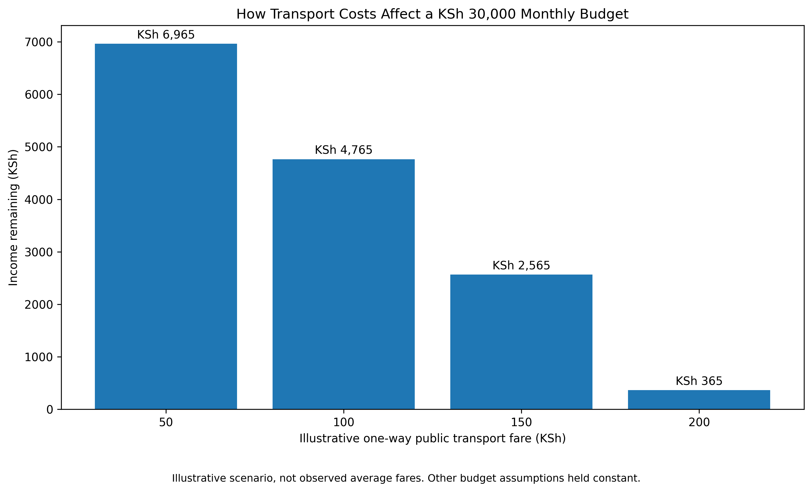

# Kenya Cost of Living Analysis (2025–2026)

A data-driven investigation into changing consumer prices, public transport costs, household budget pressure, and the purchasing power of KSh 1,000 in Kenya.

This project uses Python and publicly attributed Kenya National Bureau of Statistics (KNBS) price observations to examine price movements between September 2025 and September 2026. It combines price-change calculations, a selected grocery price basket, an illustrative household budget, and transport-cost sensitivity analysis.

## Research Question

**How are changing consumer prices and public transport costs affecting the monthly budget of a low-income household in Kenya?**

The project explores this question through a hypothetical household scenario rather than claiming to represent every Kenyan household.

## Key Findings

### 1. Selected grocery price basket

An audit of the 10 selected grocery items found that their combined listed prices increased between September 2025 and September 2026.

| Measure | September 2025 | September 2026 |
|---|---:|---:|
| Sum of selected listed prices | KSh 1,275.44 | KSh 1,347.40 |

- **Absolute increase:** KSh 71.96
- **Percentage increase:** 5.64%

The percentage change is calculated as:

`((September 2026 total - September 2025 total) / September 2025 total) * 100`

The basket is a comparison of selected price observations, not a monthly household food bill or the official KNBS consumer price index basket. Items have different package sizes and units, so their summed prices should not be interpreted as the cost of feeding a household for a month.

The selected items are loose maize flour, white wheat flour, white bread, fresh packeted milk, eggs, cooking oil, sukuma wiki, tomatoes, beans, and sugar.

### 2. Transport-cost sensitivity analysis

The project models a hypothetical household with:

- Monthly income of KSh 30,000
- One adult and one child
- 22 commuting days per month
- Two one-way public transport journeys per working day

The table shows how different assumed one-way fares affect monthly transport spending and the remaining income under the model's budget assumptions.

| Assumed one-way fare | Monthly transport cost | Income remaining |
|---:|---:|---:|
| KSh 50 | KSh 2,200 | KSh 6,965 |
| KSh 100 | KSh 4,400 | KSh 4,765 |
| KSh 150 | KSh 6,600 | KSh 2,565 |
| KSh 200 | KSh 8,800 | KSh 365 |



**Interpretation:** Under the model, increasing the assumed one-way fare from KSh 50 to KSh 200 raises monthly transport costs from KSh 2,200 to KSh 8,800. With other budget items held constant, the remaining income falls from KSh 6,965 to KSh 365.

These are hypothetical scenarios, not verified average matatu fares. Actual transport spending depends on location, route, travel frequency, and fare changes.

### 3. Illustrative household budget

The household budget model uses assumed monthly income of KSh 30,000 and a set of estimated or provisional expenses.

| Budget measure | Amount |
|---|---:|
| Assumed monthly income | KSh 30,000 |
| Total modelled monthly expenses | KSh 25,235 |
| Income remaining | KSh 4,765 |
| Share of income spent | 84.1% |

The model includes rent, food, transport, cooking fuel, electricity, water, phone and data, child-related needs, toiletries and cleaning supplies, and healthcare or emergencies.

The rent figure uses a national reference price, while several other expense categories are planning assumptions. The food budget is a separate illustrative estimate and is not calculated from the selected grocery price basket.

**Interpretation:** In this scenario, approximately 84.1% of monthly income is allocated to the listed expenses. The remaining KSh 4,765 is sensitive to the assumptions used and should not be treated as a measured household saving or disposable-income average.

## Data Sources

- [Kenya National Bureau of Statistics (KNBS) CPI Explorer](https://cpiexplorer.knbs.or.ke/)
- [KNBS: Consumer Price Indices and Inflation Rates, September 2026](https://www.knbs.or.ke/reports/consumer-price-indices-and-inflation-rates-september-2026/)

The raw price observations are preserved in `data/raw/knbs-prices.csv`. The dataset contains 16 selected observations with September 2025 and September 2026 prices.

## Methodology

The analysis follows a reproducible workflow:

1. **Data loading:** Load the raw CSV into a pandas DataFrame.
2. **Data inspection:** Review the dataset structure, column names, units, and source attribution.
3. **Price-change calculations:** Calculate absolute changes in Kenyan shillings and percentage changes for each item.
4. **Calculation audit:** Independently reproduce the calculations from the original price columns and check the results.
5. **Selected basket analysis:** Compare the combined listed prices of 10 specified grocery items across the two periods.
6. **Household budget modelling:** Sum the modelled monthly expense categories and calculate the remaining income.
7. **Transport sensitivity analysis:** Vary the assumed one-way fare while holding other budget assumptions constant.
8. **Visualisation:** Use Matplotlib to communicate the transport scenarios.
9. **Documentation:** Record assumptions, data sources, limitations, and interpretation in the notebook and project documentation.

## Repository Structure

```text
kenya-cost-of-living-2026/
├── data/
│   ├── raw/
│   │   └── knbs-prices.csv
│   └── processed/
│       ├── transport_sensitivity_analysis.csv
│       └── household_budget_audit.csv
├── visuals/
│   └── transport_sensitivity_analysis.png
├── kenya_cost_of_living_analysis.ipynb
└── README.md
```

The raw data is kept separate from processed outputs to make the workflow easier to inspect and reproduce.

## Tools and Skills Demonstrated

- **Python** — data analysis and calculations
- **pandas** — data loading, filtering, transformation, and aggregation
- **Matplotlib** — data visualisation
- **Google Colab** — cloud-based notebook development
- **GitHub** — version control, project documentation, and portfolio presentation
- **Data validation** — independent recalculation and numerical checks
- **Analytical communication** — explaining findings, assumptions, and limitations

## Limitations

- The analysis uses 16 selected price observations, not the full set of goods and services used to calculate the official CPI.
- The selected grocery price basket is illustrative and is not an official KNBS consumption basket.
- The sum of listed prices does not represent monthly food expenditure.
- The household budget includes provisional assumptions that require validation against actual household expenditure data.
- The transport fares are hypothetical scenarios, not verified market averages.
- The national reference rent may differ substantially from rents in specific towns, estates, or neighbourhoods.
- A two-period comparison identifies price movements but does not establish their causes.
- The hypothetical household scenario is not statistically representative of the average Kenyan household.

## Conclusion

This project demonstrates how publicly attributed price observations can be transformed into an auditable analysis of price movements and household budget scenarios.

The selected grocery price observations increased by 5.64% between the two comparison periods. The transport sensitivity model also shows that higher assumed commuting fares can substantially reduce the income remaining under a fixed household budget.

These findings illustrate potential budget pressure within the stated assumptions. They should not be interpreted as a complete measure of inflation, a representative estimate of Kenyan household expenditure, or proof of the causes of changing prices.

## Reproducibility

The notebook, raw dataset, processed scenario outputs, and visualisation are included in this repository. The notebook is the main entry point for reviewing the calculations and understanding the assumptions.

To reproduce the analysis, open `kenya_cost_of_living_analysis.ipynb` in Google Colab or another compatible Jupyter environment and execute the cells in order.

---

*Portfolio project for demonstrating entry-level data analysis, data validation, visualisation, and analytical communication. Price observations are attributed to KNBS; modelled household expenses and transport scenarios are explicitly identified as illustrative assumptions.*
